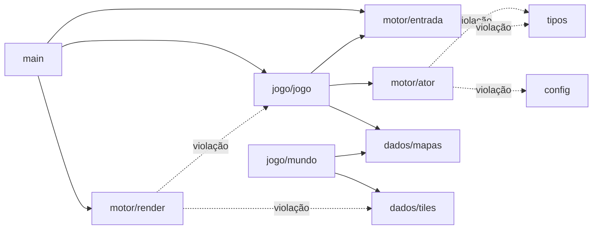
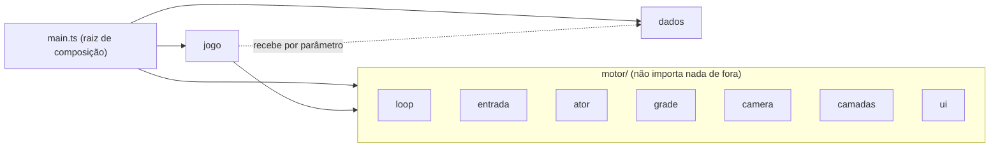

# P-002: Separar o motor do jogo

| Campo | Valor |
|-------|-------|
| Status | Rascunho |
| Criada em | 2026-11-08 |
| Depende de | Nada para as etapas 1 a 7. As etapas 8 e 9 só fazem sentido quando houver um segundo jogo |

## Objetivo

Fazer `src/motor/` virar um motor de verdade: um conjunto de peças genéricas (loop, entrada,
movimento em grade, câmera, desenho por camadas, janelas de texto) que **não sabe nada da
Vila de Pedravento**. O jogo passa a ser quem usa o motor, e nunca o contrário. No fim, o
motor pode sair para um pacote próprio e servir a um segundo jogo.

## Vale a pena agora?

Resposta curta: **a fronteira, sim; o pacote, ainda não.**

O conselho clássico de game dev é "faça jogos, não motores": quem escreve o motor antes do
jogo inventa abstrações para problemas que não tem. Um motor bom é **extraído** de jogos
que funcionam, não projetado no vazio. Com um jogo só, você não sabe ainda o que é genérico
e o que é específico da Vila.

Mas há dois motivos para começar pela fronteira já:

1. **A P-001 precisa dela.** A etapa 0 do editor quer reaproveitar o desenho dos tiles, e a
   etapa 7 quer rodar o motor com um mapa que não está em `mapas.ts`. As duas esbarram nos
   mesmos acoplamentos listados abaixo.
2. **É o assunto que você quer estudar.** Uma regra de dependência explícita e verificada é
   o núcleo de toda modularização, em jogo ou em sistema corporativo. Dá para praticar isso
   em 1.000 linhas, sem pagar o custo de um pacote separado.

Por isso as etapas 1 a 7 acontecem **dentro de `rpg-tiles/`**, só reorganizando pastas e
imports, com o jogo idêntico ao final de cada uma. Mover para um pacote (etapas 8 e 9) fica
para quando houver um segundo jogo que prove o que é genérico: a "regra de três" aplicada a
motores.

## O que se aprende

- **Regra de dependência:** `jogo → motor`, nunca `motor → jogo`. Arquitetura é, antes de
  tudo, a direção das setas de import.
- **Inversão de controle:** um motor é um *framework*, não uma biblioteca. É ele quem chama
  o seu código (`atualizar`, `desenhar`), o famoso "não nos ligue, nós ligamos para você".
- **Raiz de composição:** um único lugar (`main.ts`) que conhece todo mundo e monta as peças.
  Todos os outros arquivos só conhecem contratos.
- **Contratos no lugar de imports:** o motor declara o formato que precisa (uma função
  `desenharTile`, uma lista de desenháveis, um catálogo de mapas) e o jogo entrega.
- **O que é motor e o que é jogo num RPG de SNES**, e por que essa linha muda conforme o
  número de jogos que usam o motor.
- **API pública vs. interna** de um pacote (`index.ts`) e npm workspaces (etapa 8).

## Diagnóstico: onde o motor conhece o jogo hoje

| # | Onde | Problema |
|---|------|----------|
| 1 | `motor/render.ts` importa `Jogo` | O renderizador lê `jogo.estado`, `jogo.banner`, `mundo.inventario`. Ele só funciona com *este* jogo. |
| 2 | `motor/render.ts` importa `TILES` e tem o `switch` de `grama`, `arvore`, `telhado`… | A arte da Vila mora dentro do motor. Um tile novo exige mexer no motor. |
| 3 | `motor/render.ts` desenha o HUD "Itens:", o banner e as cores do herói | Interface e personagem do jogo dentro do motor. |
| 4 | `motor/*` importa `../tipos` | `tipos.ts` mistura tipos do motor (`Dir`, `TileDef`) com tipos do jogo (`NpcDef` com falas, `BauDef`, `Comportamento`). |
| 5 | `motor/ator.ts` importa `../config` | `config.ts` mistura constantes do motor (`TILE`, `ESCALA`, vista) com regras do jogo (`VEL_HEROI`, `VEL_TEXTO`). |
| 6 | `jogo/mundo.ts` importa `MAPAS` e `TILES` direto | O mundo não consegue rodar um mapa que não esteja no arquivo. É exatamente o bloqueio da P-001, etapa 7. |
| 7 | `main.ts` liga os botões de toque e roda o loop na mão | O loop é a peça mais genérica de todas e não está no motor. |

## Onde se quer chegar

A linha entre os dois, para este projeto:

| Motor (genérico) | Jogo (Vila de Pedravento) |
|------------------|---------------------------|
| Game loop com `dt` e o contrato `{ atualizar, desenhar }` | A máquina de estados `explorando / diálogo / transição` |
| Entrada (teclado + toque, pilha de direções, ação consumível) | Quais teclas existem e o layout dos botões na tela |
| `Ator`: movimento tile a tile, posição lógica + visual | Herói, NPCs e o que cada um faz |
| Grade de tiles + tabela de atributos (`solido`) | A legenda `TILES` e os mapas |
| Câmera presa às bordas do mapa | Quem a câmera segue |
| Desenho por camadas: chão, objetos ordenados por Y, interface, fade | A arte de cada tile, personagem e baú |
| Janela de texto: caixa, quebra de linha, máquina de escrever | Cores da janela azul, falas, HUD de itens, banner |
| Fade (0 a 1) | Quando trocar de mapa (portais) |
| — | Flags, baús, placas, inventário, falas condicionais, IA de NPC |

Duas escolhas da tabela merecem comentário:

- **A IA de NPC fica no jogo.** `vagando` e `rota` parecem genéricos, mas o NPC carrega
  falas e cores, que são do RPG. Só vale subir para o motor quando um segundo jogo quiser os
  mesmos comportamentos.
- **A máquina de estados fica no jogo.** O motor só oferece o contrato que o loop chama. O
  `switch` sobre `estado.tipo` continua inteiro em `jogo.ts`, que é o princípio 5 do
  `CLAUDE.md`. Uma pilha de cenas no motor seria uma generalização prematura; se o menu do
  E-03 pedir uma, ela entra nesse exercício.

## Fora do escopo

- Mudar o comportamento ou a aparência do jogo. Ao fim de cada etapa a Vila tem que ser
  idêntica, pixel a pixel.
- ECS, sistema de plugins, linguagem de script, áudio, carregamento de assets.
- Publicar o motor no npm. O pacote da etapa 8 é local, via workspaces.
- Tamanho de tile ou resolução configuráveis por jogo. `TILE = 16` continua constante; isso
  só muda se um segundo jogo precisar.
- Qualquer dependência de runtime. Continua só TypeScript e Vite.

## Etapas

Toda etapa termina com `scripts/checar.sh` passando e o jogo igual no navegador e no
Artefato.

- [ ] **Etapa 1: fronteira visível.** Um script sem dependências, `scripts/fronteiras.mjs`,
  lê os `import` de `src/motor/**` e lista todo import que sai da pasta. O `checar.sh` passa
  a mostrar a lista, sem falhar ainda. **Pronto quando:** o script lista as violações da
  tabela do diagnóstico. **Conceito:** arquitetura como regra de dependência verificável; a
  lista de violações vira o placar da proposta.

- [ ] **Etapa 2: tipos e constantes do motor.** `Dir`, `DELTA`, `OPOSTA` e `TileDef` vão
  para `motor/tipos.ts`; `TILE`, `VIEW_W`, `VIEW_H` e `ESCALA` vão para `motor/config.ts`.
  `tipos.ts` e `config.ts` da raiz ficam só com o que é do jogo e reexportam o resto, para
  não quebrar imports. **Pronto quando:** `ator.ts` e `entrada.ts` saem da lista do
  script. **Conceito:** um módulo é dono dos seus tipos; quem depende importa dele.

- [ ] **Etapa 3: o loop vira do motor.** `motor/loop.ts` com
  `iniciarLoop(canvas, { atualizar(dt), desenhar(ctx, tempo) })`, e
  `ligarBotoesDeToque()` em `motor/entrada.ts`. O `main.ts` fica só montando as peças.
  **Pronto quando:** `main.ts` não tem nenhum `requestAnimationFrame` nem
  `addEventListener`. **Conceito:** inversão de controle e raiz de composição; framework
  vs. biblioteca.

- [ ] **Etapa 4: a arte sai do motor.** `desenharTile`, `desenharPersonagem` e
  `desenharBau` mudam para `jogo/arte.ts`. O motor fica com `motor/camadas.ts`: câmera,
  laço sobre os tiles visíveis chamando um `desenharTile` recebido por parâmetro, lista de
  desenháveis `{ y, desenhar }` ordenada por Y, e o fade. **Pronto quando:** `render.ts`
  não importa `TILES` e um tile novo só mexe em `dados/` e `jogo/arte.ts`. **Conceito:** o
  motor decide *o que* desenhar e *em que ordem*; o jogo decide *como* cada coisa aparece.
  É a mesma separação lógica/aparência do princípio 1, um nível acima.

- [ ] **Etapa 5: interface com tema.** `motor/ui.ts` com a janela (recebe um tema de
  cores), a quebra de linha e a caixa de texto com máquina de escrever. O HUD de itens, o
  banner e o tema azul estilo Final Fantasy passam a ser montados em `jogo/hud.ts`.
  **Pronto quando:** `render.ts` não importa mais `Jogo` e o motor não contém a palavra
  "Itens". **Conceito:** componentes de interface reutilizáveis; tema como dado.

- [ ] **Etapa 6: catálogo injetado.** `Mundo` e `Jogo` recebem
  `{ mapas, tiles, inicio }` por parâmetro em vez de importar `MAPAS`, `TILES` e
  `INICIO`. A consulta à grade (`tileEm`, "é sólido?") vira `motor/grade.ts`, e o
  `livre()` do Mundo passa a usá-la. **Pronto quando:** dá para criar um `Jogo` com um mapa
  montado na hora, sem passar por `mapas.ts`. **Conceito:** injeção de dependência; o
  mundo é uma instância de dados, não um módulo com dados embutidos. É o mesmo pré-requisito
  da P-001, etapa 7.

- [ ] **Etapa 7: travar a fronteira.** O script da etapa 1 passa a falhar quando encontra
  violação, e `checar.sh` falha junto. `motor/index.ts` vira a API pública: o jogo só
  importa de `motor/index`, nunca de arquivos internos. README (ordem de leitura) e
  `CLAUDE.md` (arquitetura) atualizados. **Pronto quando:** a lista está vazia e um import
  de teste de `jogo/` dentro de `motor/` faz o `checar.sh` falhar. **Conceito:** regra que
  ninguém verifica não é regra; API pública vs. detalhes internos.

- [ ] **Etapa 8: motor como pacote (opcional).** `npm workspaces` na raiz do repositório e
  o motor em `motor/` como pacote local (`"name": "motor"`, sem build próprio: o Vite
  compila o TypeScript direto). `rpg-tiles` declara a dependência e importa
  `from 'motor'`. **Pronto quando:** `rpg-tiles` roda e gera o Artefato igual, e a fronteira
  é garantida pelo próprio pacote, que não tem como enxergar `rpg-tiles/`. **Conceito:**
  pacote, `exports`, workspaces e por que o limite físico vale mais que uma convenção.

- [ ] **Etapa 9: segundo jogo (opcional).** Um jogo pequeno em pasta irmã, usando o mesmo
  motor, de outro gênero. Sugestão: um puzzle de empurrar caixas, que usa grade, ator,
  entrada, câmera e loop, mas não usa diálogo. **Pronto quando:** os dois jogos rodam, e uma
  mudança no motor aparece nos dois. **Conceito:** a regra de três na prática. O segundo
  jogo vai mostrar o que ainda era "RPG disfarçado de motor", e isso é o resultado mais
  instrutivo da proposta.

## Decisões técnicas

- **Pasta antes de pacote.** As etapas 1 a 7 só movem arquivos dentro de `rpg-tiles/src/`.
  Cada uma é um commit pequeno, fácil de revisar e de desfazer.
- **Como verificar a fronteira.** Recomendado: um script Node de umas 30 linhas que lê os
  imports com regex. Ele é legível, explica a regra no próprio código e não exige
  ferramenta nova. Alternativas: `tsconfig` separado para o motor com `rootDir` em
  `src/motor` (o `tsc` reclama sozinho de import para fora, mas exige *project
  references* e a mensagem de erro é obscura), ou ESLint com `no-restricted-imports`
  (dependência nova, vai contra a convenção do projeto).
- **Reexportar durante a transição.** Quando um tipo muda de casa (etapa 2), o arquivo
  antigo reexporta por um tempo para nenhuma etapa quebrar o resto do jogo. Os
  reexports saem na etapa 7.
- **Contratos como funções, não classes base.** O motor recebe funções
  (`desenharTile`, `atualizar`) e objetos de dados, no estilo do `Ator` atual. Nada de
  `abstract class Cena`. Isso mantém o princípio 3 (composição).
- **Nada de comportamento novo.** Cada etapa é refatoração pura. Se aparecer vontade de
  melhorar algo no caminho, vira linha no backlog.

## Relação com a P-001

As duas propostas se tocam em dois pontos:

- **P-001, etapa 0** previa `motor/desenhoTiles.ts`, um módulo compartilhado no motor. Com
  esta proposta, a arte é do jogo: o editor importaria `jogo/arte.ts`. O conceito
  ("reaproveitar o renderizador sem duplicar") não muda, só o endereço.
- **P-001, etapa 7** pede que `Jogo` e `Mundo` recebam o catálogo de mapas. É a etapa 6
  daqui.

## Perguntas em aberto

1. **Ordem com a P-001.** Recomendado: etapas 1 a 4 desta proposta antes da etapa 0 da
   P-001, e a etapa 6 desta antes da etapa 7 da P-001. Assim o editor já nasce do lado
   certo da fronteira. Concorda, ou prefere começar pelo editor e refatorar depois?
2. **Endereço da arte.** Mudar a P-001 etapa 0 para usar `jogo/arte.ts` em vez de
   `motor/desenhoTiles.ts`?
3. **IA de NPC.** Fica no jogo (recomendado) ou já sobe para o motor?
4. **Etapas 8 e 9.** Ficam como opcionais para depois, ou você já tem um segundo jogo em
   mente? Se tiver, ele muda o que vale a pena generalizar.
5. **Branches divergentes.** A loja (E-01) foi feita no branch
   `claude/wizardly-mayer-dsq3le`, e os docs de evolução no `claude/docs-evolucao`. Os dois
   saíram do mesmo commit e nenhum contém o outro. Antes da etapa 1, vale juntá-los num
   branch só, para a refatoração já incluir a loja e o tile `prateleira`.

## Diário

_Nenhuma etapa feita ainda._
